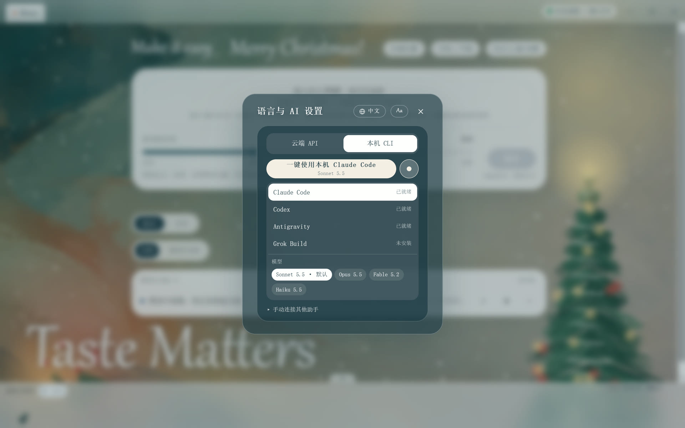
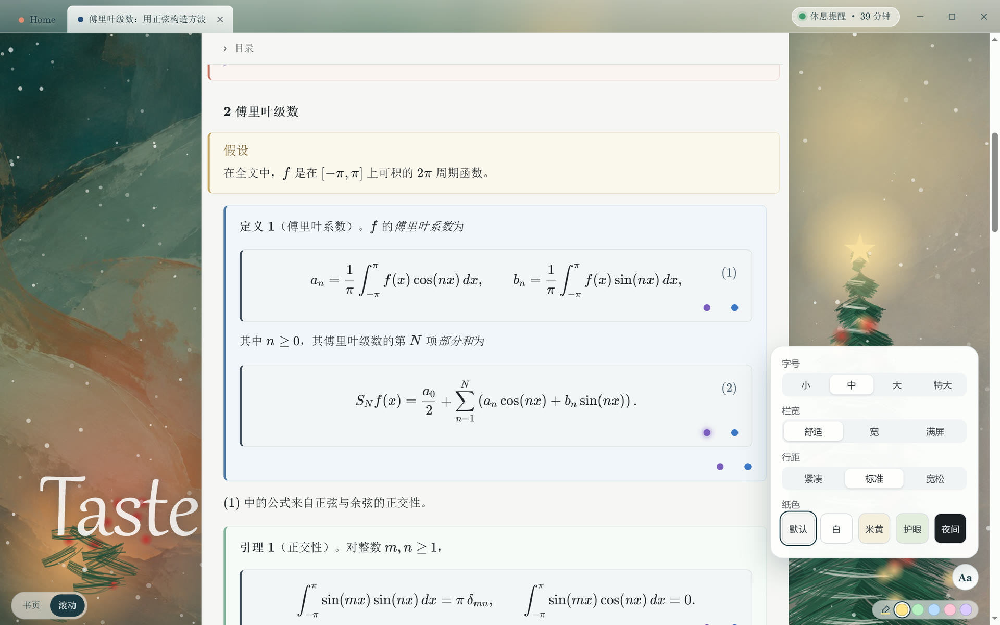
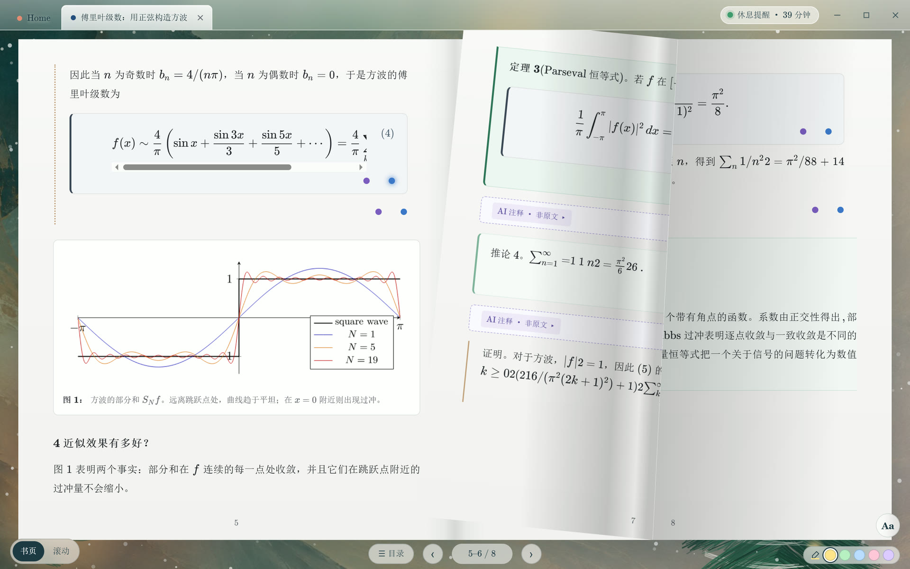
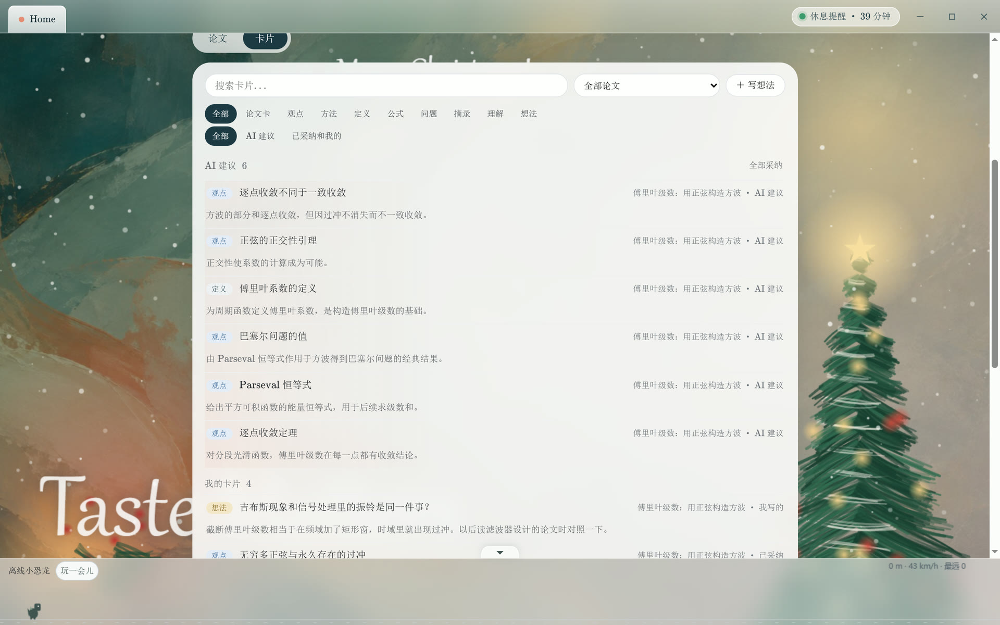
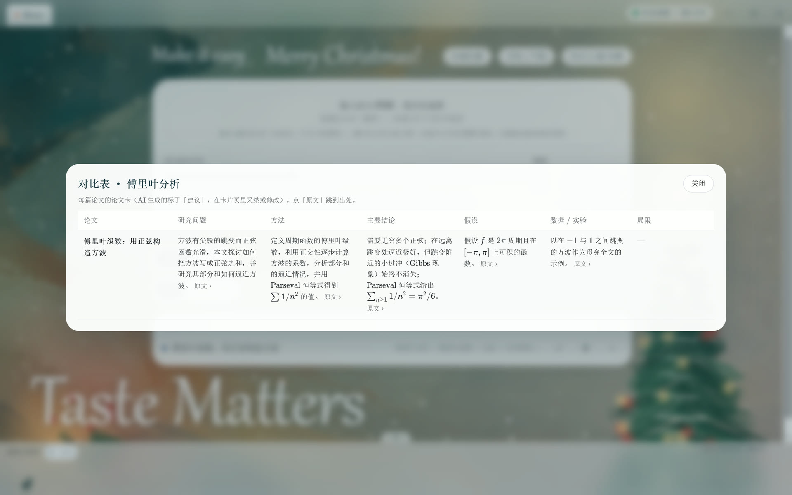
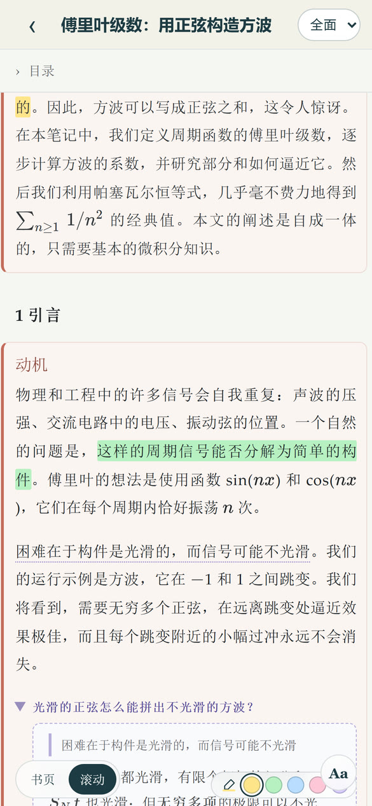
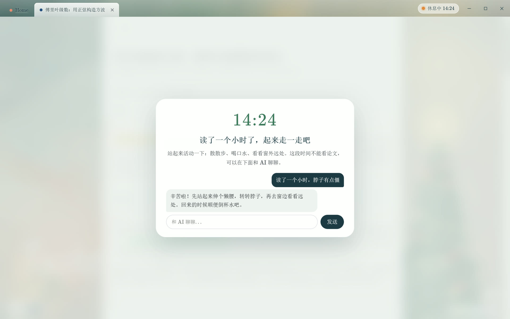

  

<h1 align="center">Make It Easy</h1>

  <b>The PDF Dimension Lifter</b> 
  <b><i>Drop in a PDF you can't follow. Get back a book you can.</i></b> 
  <i>Faithful translation, clear logical structure, page-flip reading, highlights with in-place Q&amp;A, and live interactive visualizations for any formula you're stuck on. Read on your phone or tablet too.</i>

  
  
  

  <a href="https://github.com/makeiteasy-app/make-it-easy/releases/latest"><b>⬇ 下载最新版（Windows）</b></a>
  &nbsp;·&nbsp; <a href="MANUAL.md">使用说明书</a>
  &nbsp;·&nbsp; <a href="CHANGELOG.md">更新日志</a>
  &nbsp;·&nbsp; <a href="https://github.com/makeiteasy-app/make-it-easy/issues">问题反馈</a>

  

## 为什么做这个

读教材或者论文时，你可能也遇到过这些情况：

- 一个推导连着跳了三步，翻来覆去也看不出中间发生了什么；
- 公式写得清清楚楚，可它到底在"做"什么，脑子里没有画面；
- 外文文献交给机器翻译，术语译歪了，公式编号也乱了；
- 读到第三节，已经忘了作者的动机是什么，这一步在证明哪个结论；
- 某一句没看懂，想问 AI，却得把整篇论文重新贴一遍。

Make It Easy 想解决的就是这几件事。把论文、教材或讲义的 PDF 拖进来，点「编译」，几分钟后得到一份能读懂的版本：原文忠实翻译，论证结构标出来，排成一本可以翻页的书。哪条公式看不懂，点一下，AI 就为它现场做一个能动手操作的演示；哪句话看不懂，选中它直接问，回答就留在那句话下面。

## 功能

下面按使用顺序介绍全部功能。每一项的详细操作见[使用说明书](MANUAL.md)。

### 🔌 接入你自己的 AI

整个流程（解析、翻译、理解结构、写注释和演示）只用你接入的**同一个大模型**，不混用别的小模型。三种接入方式：

| 方式 | 说明 |
|---|---|
| **本机命令行（推荐）** | 用你电脑上已经登录的 **Claude Code**、**Codex**、**Antigravity CLI**（Google 的 Gemini 现在通过它用）或 **Grok Build**（xAI 官方的命令行助手），走你自己的订阅，不需要 API 密钥。没装会帮你装，没登录会打开官方登录窗口。每个助手都可以选模型，比如 Claude 的 Sonnet / Opus / Fable / Haiku，也可以让它自己决定。 |
| **云端 API** | OpenAI、Anthropic、Google Gemini、DeepSeek、**xAI (Grok)**，或任何 OpenAI 兼容接口。「高级」里可以从这家现在的型号里选，也可以自己填；以前保存的已停用型号会自动换成替代型号。密钥只存在本机，系统支持时加密保存。 |
| **本地桥接** | 把任务交给别的已登录助手（例如在 Cursor 上搭的 Grok Bot），填 webhook 即可；桥接没在运行时可以改用复制粘贴。 |

文献库右上角的「**语言与 AI 设置**」随时可以改：

- **成品语言** 12 种：简体中文、繁体中文、English、日本語、한국어、Español、Français、Deutsch、Português、Русский、العربية、हिन्दी。换语言后重新编译，只重新翻译，解析结果复用。
- **字体**分西文和本地文字两部分选：西文默认是论文常用的 Computer Modern（和公式同一种字形），也可以换成 Palatino、EB Garamond、Literata 等；中文有宋体、霞鹜文楷、仿宋、楷体等，日、韩、阿拉伯、天城文也各有几款。App 自带开源字体，改了立即生效。

### 📚 文献库：拖进来，点「编译」

- **投递**：把 PDF 拖进投递框，选 AI 辅助层级，点「编译」。同一篇重复投递不会多出一条。
- **四个辅助层级**：

  | 层级 | 内容 |
  |---|---|
  | 纯净 | 忠实翻译、重新排版、公式重新渲染，不放任何 AI 写的内容 |
  | 基础 | 加上定义、定理、证明等语义框，动机、方法、步骤、结论、转折的逻辑分框；自动生成知识卡片 |
  | 深入 | 加上更细的逻辑层次，标出值得做成演示的公式 |
  | 全面 | 加上更多 AI 注释，并提前生成几个演示 |

  以后换层级，已经做好的部分直接复用，只补新的部分。
- **进度**：显示当前在做哪一步、这一步还要多久、全部还要多久。超过 8 页的先出大纲，再分块同时处理；30 页左右大约 10 分钟。**翻译好的章节可以先读。**
- **暂停和继续**：编译中可以「暂停」，正在进行的请求立刻停下。暂停、中途关掉 App、额度用完或出错之后，点「继续」从缺的地方接着做，做完的页、译文和逻辑框都保留。
- **出错时告诉你原因**：写明是额度用完、密钥无效、连不上网络、找不到命令行助手、PDF 打不开还是 AI 回复格式不对，以及怎么办。还能「复制诊断信息」（不含论文内容和密钥）发给我们。
- **整理**：按主题自动分组，简称按「缩写：一句话说明」生成，都可以改；可以按分组筛选；删除整篇（进回收站，可恢复）或只删某一层。
- **编译一次就够**：之后提问、生成演示、换层级、做卡片都直接用存好的结果，不用重新编译。
- **存储位置**：设置、缓存和文献库可以一键搬到别的盘，比如 D 盘。编译完自动删掉逐页渲染图，大约省一半空间。
- **一点小心思**：首页的油画背景会随春节、中秋、圣诞、新年换装；等编译的时候，底部有一只可以玩的小恐龙，不想看见就收起来。

### 🧭 忠实翻译，论证结构标出来

- 翻译只做语言转换，**不增删、不润色、不总结**。公式、符号、编号、引用原样保留。
- 定义、定理、证明加框；动机、方法、推导、结论这些段落按 AI 读出的逻辑分框，类别名写在框的左上角。
- 识别不可靠的公式显示原图，标「原文图像」，点一下打开原 PDF 的那一页对照。
- AI 写的注释标「AI 注释 · 非原文」，可以一条条隐藏，也可以一次全部放回来。

### 📖 阅读：滚动或翻页，怎么舒服怎么读

- **滚动版式**（默认）：长页面往下读，默认「舒适」栏宽，每行约 45 个字，字号随窗口宽度变化。
- **书页版式**：两页并排铺满窗口，翻页时纸页会弯曲、带阴影。按 `D` / `→` 下一页，`A` / `←` 上一页。公式、图表、注释和演示不会被拆到两页。底栏的「☰ 目录」每一页都能打开，点一下就翻过去。
- **阅读设置「Aa」**（右下角）：字号（小 / 中 / 大 / 特大）、栏宽（舒适 / 宽 / 满屏）、行距（紧凑 / 标准 / 宽松）、纸色（默认 / 白 / 米黄 / 护眼 / 夜间）。中文和英文、数字之间自动留空，中文段落两端对齐。
- 每篇、每层各开一个标签页，像浏览器一样切换；也可以直接打开原 PDF。

### ✨ 哪条公式看不懂，就为它做一个演示

每条公式、每个定理或证明右下角有两个小圆点：

- **紫点 · 可视化动画**：AI 写一段分步动画，点沿曲线移动、曲线变形、格子里的数值和颜色一步步变化，每一步配一句字幕。播放得很慢，每一步至少停到你读完字幕；可以暂停、上一步 / 下一步、点进度条跳到某一步、调速度（0.5× 到 1.25×），还能打开配音（用 Windows 自带的语音，不花 AI 额度）。
- **蓝点 · 可交互实验**：一步步走推导，用按钮切换参数，每一步的数值和说明都会更新。

这些演示不是事先做好的模板。AI 读这条公式和理解它需要的上下文，当场写出参数、分步推导和计算代码，几十秒后插在公式正下方，页面不刷新。交给你之前都先在本地沙箱里试运行，算不出来的不会给你看；用到的示例数字标「简化示例 · AI 生成」，不冒充原文。生成过的圆点会发出一圈微光；等不及可以点「中止」，不白花额度。

**不只是公式**：选中任意一段，在提问框左边切到「可视化」或「可交互」，写一句想看什么（也可以不写），AI 就针对这一段做一个，放在这段下面。

### ✍️ 画笔高亮，选中就问

- **高亮**：右下角选一支画笔颜色（黄、绿、蓝、粉、紫），按住右键拖过一段文字就涂上。点高亮可以换颜色或删掉。
- **提问**：左键选中一段，下方出现提问框，写下问题回车。AI 只收到选中的文字、它所在的几段、引用的定理公式原文和全文大纲，一般一千 token 左右，**不重发整篇论文**。
- **回答留在原处**：出现在那段文字正下方，公式照常排好，标「AI 回答 · 非原文」。不想看时收起成一个小三角。
- **接着追问**：对同一处再问，或在回答底部的「追问」里写，回答接成一串，AI 记得前面问过什么。
- **对回答有疑问**：可以选中 AI 回答里的句子来问，或论文和回答一起选；AI 会先对照原文核对，错了就更正。演示里的字幕和说明也能选中来问。
- **几段一起问**：按住 `Ctrl` 再拖选，把不相邻的几段加进来一起问。
- **AI 会自己翻论文**：信息不够时（比如符号在前面别处定义），AI 会去这篇论文的全文里查，只能读这篇论文，读不到你电脑上的其他文件。

高亮和问答都存在本机，换版式、换层级、关掉再开都还在。

### 🗂️ 知识卡片与对比表

为以后对比论文、写综述准备素材，一张卡片只放一个要点。每张卡片把**作者原话**（带出处，保存前和原文逐字核对）、**AI 概括**、**你的想法**分开存。

- **编译时自动生成**（基础层及以上）：每篇 1 张论文卡（研究问题、方法、主要结论、假设、数据、局限）和 5–12 张观点卡，先标「AI 建议」，等你采纳。AI 给的原话在原文里逐字找不到就丢掉。
- **阅读时收进卡片**：选中一段、一条 AI 回答或一个逻辑框，点「收进卡片」，可以顺手写一句自己的想法。
- **卡片页**：文献库上方切到「卡片」，搜索、按类型和论文筛选、采纳、修改、删除，自己写想法卡；点「跳到原文」直接回到出处并闪一下。
- **分组对比表**：每个分组一张表，组里每篇论文的问题、方法、结论、局限排在一起，每一格都能跳回原文。

- **文献信息**：作者、年份、期刊、DOI、arXiv 号自动整理好，可以导出 BibTeX。

### 📱 在手机、平板上读

通过 [Tailscale](https://tailscale.com)，在 iPhone、iPad 或安卓设备上读这台电脑上的文献库：翻阅论文、换辅助层级、看高亮和问答、长按选中一段提问、生成和看演示、收进卡片都可以。AI 仍在电脑上运行，手机上只要装 Tailscale，不用装别的。

  &nbsp;&nbsp;
  

首页点「手机 / 平板」，按提示开启后用手机扫二维码就行，iPhone 上还可以「添加到主屏幕」。只有登录你 Tailscale 账号、并且配对过的设备能连上，不会对家里的局域网或外网开放；手机也只能读和问，不能删论文、改设置。

### ☕ 读累了，起来走走

顶栏右边有一个药丸，圆点的颜色代表模式：

- **绿点 · 休息提醒**（默认）：每读满 1 小时，阅读页会被挡住，提醒你站起来走一走、喝口水、看看远处，15 分钟后才能接着读。休息时可以和 AI 聊聊天，首页照常能用。
- **灰点 · 一直阅读**：不计时，不提醒。

只计你真正在读的时间：电脑闲置不算，离开满 15 分钟就当作已经休息过；关掉 App 再打开，休息也还在继续。

### ⌨️ 常用快捷键

| 操作 | 作用 |
|---|---|
| `D` / `→` / `PageDown` | 书页模式：下一页 |
| `A` / `←` / `PageUp` | 书页模式：上一页 |
| 按住右键拖动 | 用当前画笔颜色高亮 |
| 左键选中 | 弹出提问框 |
| `Ctrl` + 拖选 | 多选几段一起问，或一起收进卡片 |
| 鼠标中键点标签 | 关闭标签页 |
| 双击顶栏空白处 | 最大化 / 还原窗口 |

## 我们的坚持

Make It Easy 的产品理念是一句话：**把复杂留给 AI，把简单留给用户。** 具体落到四条原则上：

| 原则 | 具体怎么做 |
|---|---|
| 🛡️ 忠实于作者 | 作者写的内容一个字都不改。AI 写的解释、注释、演示全部放在单独一层，标明「AI 生成」，可以随时隐藏。 |
| 强大能力 | 哪里看不懂，就为那一处现场写一个能操作的演示，先试跑校验再交给你。 |
| 极简界面 | 拖入 PDF、点「编译」，主要就这两步。接入 AI、搬存储位置、额度用完后补完，都是点一下。 |
| 专注于阅读 | 翻页阅读，演示插在原位不打断，不需要的辅助随时收起。 |

**Taste Matters.** 读一份难懂的文献已经够累了，我们希望至少看着舒服一点。所以有会换装的首页、会翻卷的纸页，和那只小恐龙。

## 安装

1. 在 [Releases](https://github.com/makeiteasy-app/make-it-easy/releases/latest) 下载 `Make-It-Easy-Setup-<版本>.exe`，运行时可以自己选安装位置，不必装在 C 盘。也可以下载 zip 免安装版，解压后运行 `Make It Easy.exe`。
2. 安装包暂时没有数字签名，Windows 可能提示「已保护你的电脑」，点「更多信息」再点「仍要运行」。
3. 打开后选一种 AI 接入方式，就可以拖入 PDF 了。

每一步怎么用，见[使用说明书](MANUAL.md)。

电脑端仅支持 64 位 Windows 10 / 11；手机、平板通过 Tailscale 连到电脑上读（iOS、安卓都可以）。

想先试试效果，可以下载 Release 里的 `fourier-square-wave.pdf`。这是一篇为演示专门写的三页短文，讲怎样用正弦波拼出方波，可以自由使用（CC0）。本页的截图都来自它。

## 常见问题

**要花钱吗？**
目前发布的版本个人学习、研究和学校使用都免费（商业用途需要授权，见下方「许可」）。AI 用的是你自己的订阅或 API 额度。用本机的 Claude Code、Codex、Antigravity CLI 或 Grok Build 时，走的是你已有的订阅。

**能在手机上用吗？**
可以在手机、平板上读，但要电脑开着：电脑上的 Make It Easy 负责编译和 AI，手机通过 Tailscale 连过去。编译新论文仍在电脑上做。详见[说明书第 9 章](MANUAL.md#9-在手机或平板上读)。

**编译过的论文，之后用 AI 还要重新编译吗？**
不用。提问、生成演示、换辅助层级、做卡片都直接用存好的编译结果；只有换成品语言时要重新翻译。

**选中提问要花很多额度吗？**
不多。每次只发选中的文字、它所在的几段、引用的定理公式和你的问题，一般一千 token 左右，不会把整篇论文再发一遍；只有 AI 觉得信息不够时才会去全文里查。

**一份文献要编译多久？**
30 页左右大约 10 分钟，层级越高越久。编译中途可以先读已经翻译好的部分。

**只能读论文吗？**
不是。教材、讲义、技术报告、学位论文都可以，带公式的理工科内容效果最好。能选中文字的 PDF 处理最快；扫描版也能处理，但更慢。

**数据存在哪里？**
都在你自己的电脑上，默认在 `%APPDATA%\Make It Easy`。文献列表右上角的「存储位置」可以把设置、缓存和文献库一键搬到别的盘（例如 D 盘）。编译完成后会自动删掉逐页渲染图，大约省一半空间。

**安装后打不开？**
安装时程序会先解压到 C 盘的临时文件夹（约 400 MB，装完自动删除）。C 盘剩余空间不足 1 GB 时，安装可能中途失败。清理出空间后重新安装即可。

**我编译出来的译文可以分享吗？**
译文的授权跟随原文。原文是 CC BY 等开放许可的，可以按许可要求署名后分享；版权保留的，请只用于个人学习，不要公开分享译文。

**遇到问题怎么反馈？**
在 [Issues](https://github.com/makeiteasy-app/make-it-easy/issues) 里提，选「问题报告」或「功能建议」模板；使用心得和讨论可以发在 [Discussions](https://github.com/makeiteasy-app/make-it-easy/discussions)。

## 许可

- 每个版本适用哪种条款，以发布时附带的许可为准，详见 [LICENSING.md](LICENSING.md)。目前已发布的版本（到 V5.0 alpha 为止）都采用 [PolyForm Noncommercial 1.0.0](LICENSE)：个人学习、研究、兴趣项目，以及学校、公益和科研机构使用都免费，也可以转给别人（转发时附上许可条款）。**不允许商业用途**；想在商业场景使用，请通过 Issues 联系作者。
- 本仓库只提供安装包和文档，源码不公开。
- App 用到的第三方组件（Electron、KaTeX、PDF.js、StPageFlip、开源字体等）保留各自的许可，许可文本随安装包一起提供。
- 隐私：你的文献和数据都留在自己电脑上，见 [PRIVACY.md](PRIVACY.md)。
