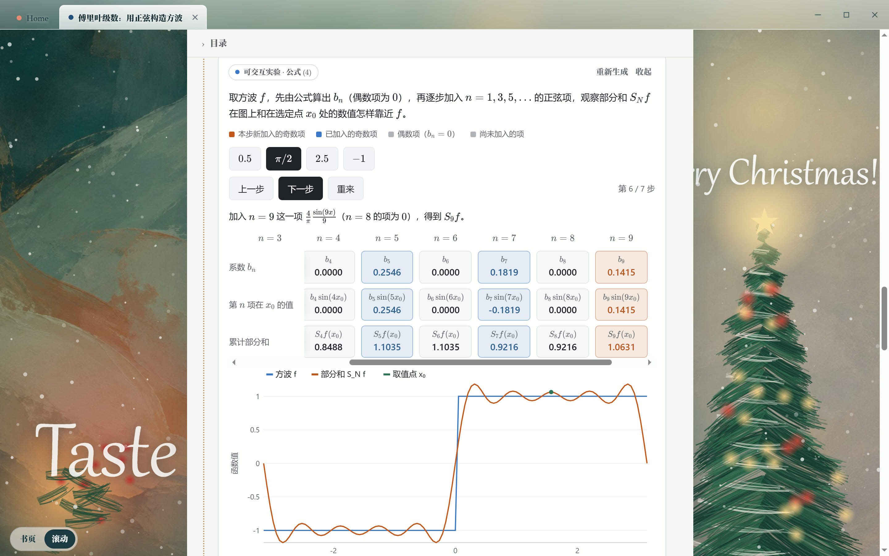

  

<h1 align="center">Make It Easy</h1>

  <b>The PDF Dimension Lifter</b> 
  <b><i>Drop in a PDF you can't follow. Get back a book you can.</i></b> 
  <i>Faithful translation, clear logical structure, page-flip reading, and live interactive visualizations for any formula you're stuck on.</i>

  <a href="https://github.com/zero-knowledge123/Make-It-Easy-Releases/releases/latest"><b>⬇ 下载最新版（Windows）</b></a>

  

这里是 Make It Easy 的下载页，只放安装包和使用说明。

## 它能做什么

把论文、教材或讲义的 PDF 拖进来，点「编译」，几分钟后得到一份能读懂的版本：原文忠实翻译，论证结构标出来，排成一本可以翻页的书。哪条公式看不懂，点一下，AI 就为它现场做一个能动手操作的演示。

### ✨ 哪条公式看不懂，就为它做一个演示

每条公式旁边有两个小圆点。蓝点生成**可交互实验**，可以改参数、上一步下一步地把推导走一遍；紫点生成**可视化动画**。演示由 AI 读懂这条公式后当场写出，交给你之前会先在本地试运行校验。

### 📖 像一本真书那样翻页

两页并排铺满窗口，`D` 或 `→` 下一页，`A` 或 `←` 上一页。公式、图表、注释和演示不会被拆到两页。左下角可以切回滚动版式。

### 🧭 忠实翻译，论证结构标出来

作者写的内容一个字都不改，公式、编号、引用原样保留。定义、定理、证明和动机、方法、结论这些段落分框标出。AI 写的解释和注释都单独标注，可以随时隐藏。

### 📚 文献库和一键接入 AI

编译好的文献自动分组，编译时显示进度和剩余时间。AI 可以用你自己已登录的 Claude Code、Codex 或 Gemini CLI（走你自己的订阅，不需要 API 密钥），也可以填云端 API 密钥。

## 安装

1. 在 [Releases](https://github.com/zero-knowledge123/Make-It-Easy-Releases/releases/latest) 下载 `Make-It-Easy-Setup-<版本>.exe`，运行时可以自己选安装位置，不必装在 C 盘。也可以下载 zip 免安装版，解压后运行 `Make It Easy.exe`。
2. 安装包暂时没有数字签名，Windows 可能提示「已保护你的电脑」，点「更多信息」再点「仍要运行」。
3. 打开后选一种 AI 接入方式，就可以拖入 PDF 了。

仅支持 64 位 Windows 10 / 11。安装时会先解压到 C 盘的临时文件夹（约 400 MB，装完自动删除），C 盘剩余空间不足 1 GB 时安装可能失败。

想先试试效果，可以下载 Release 里的 `fourier-square-wave.pdf`。这是一篇为演示专门写的三页短文，讲怎样用正弦波拼出方波，可以自由使用，本页的截图都来自它。

## 常见问题

**要花钱吗？**
个人学习、研究和学校使用免费。AI 用的是你自己的订阅或 API 额度。

**数据存在哪里？**
都在你自己的电脑上。文献列表右上角的「存储位置」可以把数据一键搬到别的盘。

**编译出来的译文可以分享吗？**
译文的授权跟随原文。请只用于个人学习，不要公开分享别人作品的译文。

**遇到问题怎么反馈？**
在本仓库的 [Issues](https://github.com/zero-knowledge123/Make-It-Easy-Releases/issues) 里留言即可。

## 许可

Make It Easy 采用 [PolyForm Noncommercial 1.0.0](LICENSE) 许可：个人学习、研究、兴趣项目，以及学校、公益和科研机构使用都免费，也可以转给别人（转发时请附上许可条款）。**不允许商业用途**；想在商业场景使用，请通过 Issues 联系作者获取商业授权。

本仓库只提供安装包，源码暂不公开。
