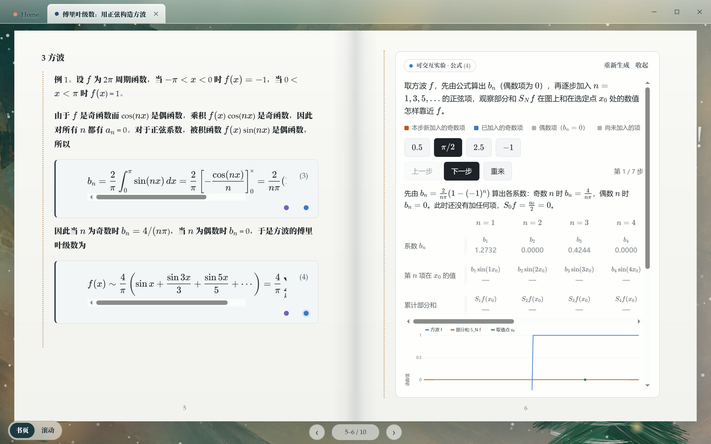
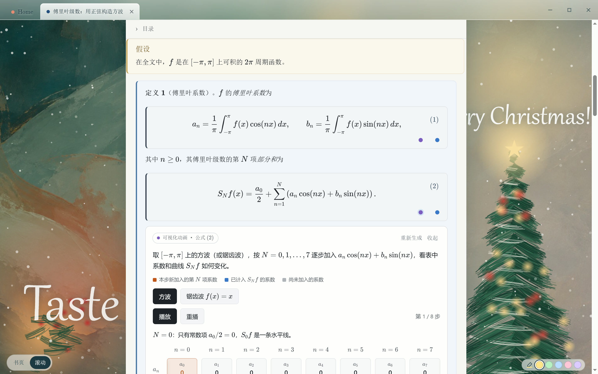
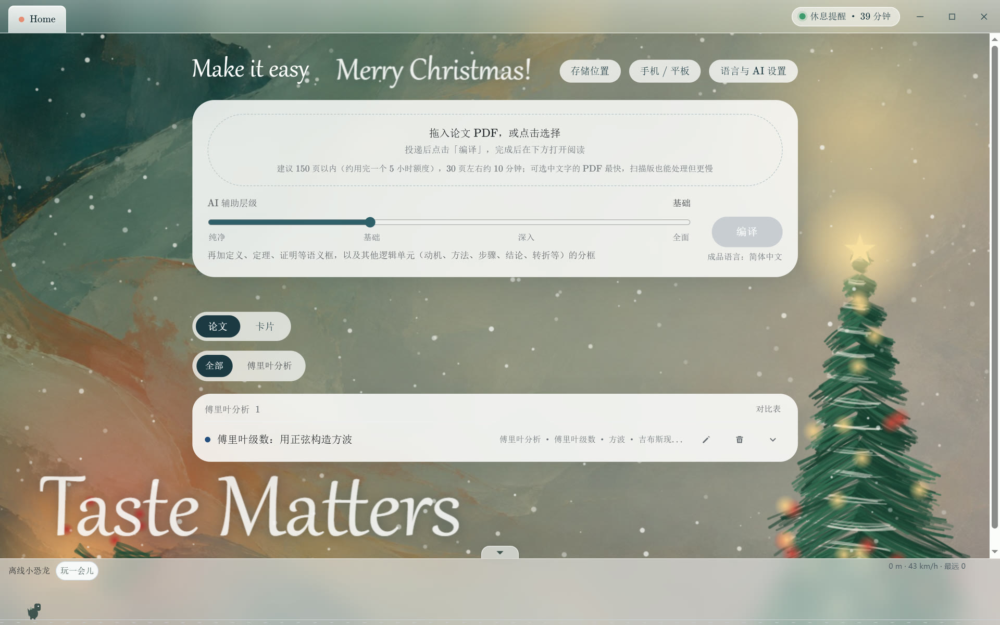

  

<h1 align="center">Make It Easy</h1>

  <b>The PDF Dimension Lifter</b> 
  <b><i>Drop in a PDF you can't follow. Get back a book you can.</i></b> 
  <i>Faithful translation, clear logical structure, page-flip reading, highlights with in-place Q&amp;A, and live interactive visualizations for any formula you're stuck on. Read on your phone or tablet too.</i>

  
  
  

  <a href="https://github.com/makeiteasy-app/make-it-easy/releases/latest"><b>⬇ 下载最新版（Windows）</b></a>
  &nbsp;·&nbsp; <a href="MANUAL.md">使用说明书</a>
  &nbsp;·&nbsp; <a href="CHANGELOG.md">更新日志</a>
  &nbsp;·&nbsp; <a href="https://github.com/makeiteasy-app/make-it-easy/issues">问题反馈</a>

  

## 为什么做这个

读教材或者论文时，你可能也遇到过这些情况：

- 一个推导连着跳了三步，翻来覆去也看不出中间发生了什么；
- 公式写得清清楚楚，可它到底在"做"什么，脑子里没有画面；
- 外文文献交给机器翻译，术语译歪了，公式编号也乱了；
- 读到第三节，已经忘了作者的动机是什么，这一步在证明哪个结论；
- 某一句没看懂，想问 AI，却得把整篇论文重新贴一遍。

Make It Easy 想解决的就是这几件事。把论文、教材或讲义的 PDF 拖进来，点「编译」，几分钟后得到一份能读懂的版本：原文忠实翻译，论证结构标出来，排成一本可以翻页的书。哪条公式看不懂，点一下，AI 就为它现场做一个能动手操作的演示；哪句话看不懂，选中它直接问，回答就留在那句话下面。

## 功能

### ✨ 哪条公式看不懂，就为它做一个演示

每条公式右下角有两个小圆点。点蓝点得到一个**可交互实验**：可以改参数，上一步、下一步地把推导走一遍。点紫点得到一个**可视化动画**：点沿着曲线走、曲线变形、格子里的数一步步变化，每一步配一句字幕，播放得很慢，至少停到你读完字幕；可以调速度，也可以打开配音（用 Windows 自带的语音，不额外花额度）。

不只是公式：选中任意一段文字，在提问框里切到「可视化」或「可交互」，写一句想看什么（也可以不写），AI 就针对这一段做一个，放在这段下面。

这些演示不是事先做好的模板。AI 会读这条公式和理解它需要的上下文，当场写出参数、分步推导和计算代码，几十秒后插在公式正下方，页面不刷新。每个演示交给你之前，都会先在本地沙箱里试运行一遍，算不出来的不会给你看。演示里用到的示例数字会标明「简化示例 · AI 生成」，不会冒充原文。

演示打开时都是暂停的，点「播放」或「下一步」才动；框的大小在载入时就按最大的一步定好，操作时不会忽长忽短、把正文挤来挤去。提前生成好的演示默认收起，生成过的圆点会发出一圈微光，点一下就展开。生成要等几十秒，等不及或点错了，占位框右上角有「中止」，会停掉这次请求，不白花额度。

### 📖 像一本真书那样翻页

两页并排铺满窗口，按 `D` 或 `→` 翻到下一页，`A` 或 `←` 回上一页，也可以点底部的 ‹ ›。翻页时纸页会弯曲、带阴影。

正文可以跨页接着排，公式、图表、注释和演示不会被拆开：放不下就把这一页剩下的地方留白，整块放到下一页。演示的框固定一整页高，分步操作时不会忽长忽短。想换回长页面滚动，点左下角的「滚动」，选择会被记住。

底栏的「☰ 目录」在每一页都能打开，标出你现在读到哪一章、每章在第几页，点一下就翻过去。

右下角的「Aa」可以调字号、栏宽、行距和纸色（默认、白、米黄、护眼绿、夜间）。正文字号会随栏宽变化，中英文之间自动留空，中文段落两端对齐。默认是滚动版式和「舒适」栏宽。

### ✍️ 画笔高亮，选中就问

- **高亮**：右下角选一支画笔颜色，按住右键拖过一段文字就涂上。点高亮可以换颜色或删掉。
- **提问**：左键选中一段，下方出现输入框，写下问题回车。AI 只收到你选中的这段、它前后几段的编译结果和你的问题，不用重读整篇论文，省时间也省额度。
- **回答留在原处**：回答出现在那段文字的正下方，公式照常排好，标明「AI 回答 · 非原文」。不想看时收起，只剩一个半透明的小三角，随时再点开。
- **接着追问**：对同一处再问，或在回答框底部的「追问」里直接写，回答接在同一个框里排成一串，AI 记得这一串前面问过什么。
- **对回答有疑问**：可以直接选中 AI 回答里的句子来问，也可以论文和回答一起选；AI 会先对照原文核对，错了就更正。演示里的字幕和说明也能选中来问。
- **几段一起问**：按住 Ctrl 再拖选，把不相邻的几段加进来一起问。
- **AI 会自己翻论文**：提问时自动带上这一处引用的定理、公式原文和全文大纲；还不够时，AI 会去这篇论文的全文里查（只能读这篇论文，读不到你电脑上的其他文件）。

高亮和问答都存在本机，换书页 / 滚动版式、换层级、关掉再开都还在，只有你点「删除」才会删。

### 🧭 忠实翻译，论证结构标出来

翻译只做语言转换，不增删、不润色、不总结。公式、符号、编号、引用原样保留，原 PDF 随时可以打开对照。

定义、定理、证明会加框，动机、方法、推导、结论这些段落也会按 AI 读出的逻辑标出来，类别名写在框的左上角，而不是按自然段机械切分。编译时可以选四个辅助层级：

| 层级 | 内容 |
|---|---|
| 纯净 | 忠实翻译、重新排版、公式重新渲染 |
| 基础 | 加上定义、定理、证明等语义框，以及动机、方法、步骤、结论、转折的逻辑分框 |
| 深入 | 加上更细的逻辑层次，标出值得做成演示的公式 |
| 全面 | 加上更多 AI 注释，并提前生成一部分演示 |

### 📚 文献库

- 编译好的文献自动按主题分组，简称按「缩写：一句话说明」生成，可以自己改。
- 编译时显示当前在做哪一步、这一步还要多久、全部还要多久。翻译好的章节可以先读。
- 超过 8 页的文献会先出大纲，再分块同时处理。30 页左右大约 10 分钟；单份建议 150 页以内，长教材可以按章节拆成几个 PDF。
- 编译中可以点「暂停」；暂停、中途关掉 App、额度用完或出错之后，点「继续」就从缺的地方接着做，已经做完的页、译文和逻辑框都保留。
- 出错时会写明是哪一类问题（额度用完、密钥无效、连不上网络、PDF 打不开等）和怎么办；点「原因」还能复制诊断信息（不含论文内容和密钥）发给我们。
- 首页的油画背景会随圣诞、新年、春节、中秋换装。等编译的时候，底部还有一只可以玩的小恐龙，不想看见就点小三角收起来。

### 🗂️ 知识卡片

- 编译完成后，AI 会给每篇论文做 1 张论文卡（研究问题、方法、结果、局限）和几张观点卡，先标成「建议」，等你采纳。卡片里作者的原话都和原文逐字核对过，对不上的直接丢掉。
- 读的时候选中一段、一条 AI 回答或一个逻辑框，点「收进卡片」就能存下来。作者原话、AI 概括和你自己的想法分开存；点「跳到原文」会回到出处。
- 首页切到「卡片」可以搜索、筛选、编辑，也能自己写想法卡；每个分组有一张对比表，把组里每篇论文的问题、方法、结果排在一起。
- 作者、年份、期刊、DOI 自动整理好，可以导出 BibTeX。

### 📱 在手机、平板上读

通过 [Tailscale](https://tailscale.com)，在 iPhone、iPad 或安卓设备上读这台电脑上的文献库：翻阅论文、看高亮和问答、长按选中一段提问、生成和看演示、收进卡片都可以。AI 仍在电脑上运行，手机上只要装 Tailscale，不用装别的。

首页点「手机 / 平板」，按提示开启后用手机扫二维码就行。只有登录你 Tailscale 账号的设备能连上，还要配对密钥，不会对家里的局域网或外网开放。

### ☕ 读累了，起来走走

顶栏右边有一个药丸，圆点的颜色代表模式：

- **绿点 · 休息提醒**（默认）：每读满 1 小时，阅读页会被挡住，提醒你站起来走一走、喝口水、看看远处，15 分钟后才能接着读。休息时可以和 AI 聊聊天。
- **灰点 · 一直阅读**：不计时，不提醒。

只计你真正在读的时间：电脑闲置不算，离开满 15 分钟就当作已经休息过。

### 🔌 接入你自己的 AI

整个流程（解析、翻译、理解结构、写注释和演示）只用你接入的**同一个大模型**，不混用别的小模型。

- **本机命令行（推荐）**：用你已经登录的 Claude Code、Codex、Antigravity CLI（Google 的 Gemini 现在通过它用）或 Grok Build（xAI 官方的命令行助手），走你自己的订阅，不需要 API 密钥。没装的话会帮你装，没登录会打开官方登录窗口。每个助手都可以选模型，也可以让它自己决定。
- **云端 API**：OpenAI、Anthropic、Gemini、DeepSeek、xAI (Grok) 或兼容接口。密钥只存在本机，系统支持时会加密保存。

API 的「高级」里，模型可以从这家厂商的常见型号里下拉选，也可以自己填。

语言、字体和 AI 接入都在文献列表右上角的「语言与 AI 设置」里改。字体分两部分选：西文默认是论文常用的 Computer Modern（和公式同一种字形），也可以换成 Palatino、EB Garamond、Literata 等；中文、日文、韩文、阿拉伯文、印地文各有几款常见字体，App 自带开源字体，不用另装。

## 我们的坚持

Make It Easy 的产品理念是一句话：**把复杂留给 AI，把简单留给用户。** 具体落到四条原则上：

| 原则 | 具体怎么做 |
|---|---|
| 🛡️ 忠实于作者 | 作者写的内容一个字都不改。AI 写的解释、注释、演示全部放在单独一层，标明「AI 生成」，可以随时隐藏。 |
| 强大能力 | 哪里看不懂，就为那一处现场写一个能操作的演示，先试跑校验再交给你。 |
| 极简界面 | 拖入 PDF、点「编译」，主要就这两步。接入 AI、搬存储位置、额度用完后补完，都是点一下。 |
| 专注于阅读 | 翻页阅读，演示插在原位不打断，不需要的辅助随时收起。 |

**Taste Matters.** 读一份难懂的文献已经够累了，我们希望至少看着舒服一点。所以有会换装的首页、会翻卷的纸页，和那只小恐龙。

## 安装

1. 在 [Releases](https://github.com/makeiteasy-app/make-it-easy/releases/latest) 下载 `Make-It-Easy-Setup-<版本>.exe`，运行时可以自己选安装位置，不必装在 C 盘。也可以下载 zip 免安装版，解压后运行 `Make It Easy.exe`。
2. 安装包暂时没有数字签名，Windows 可能提示「已保护你的电脑」，点「更多信息」再点「仍要运行」。
3. 打开后选一种 AI 接入方式，就可以拖入 PDF 了。

每一步怎么用，见[使用说明书](MANUAL.md)。

电脑端仅支持 64 位 Windows 10 / 11；手机、平板通过 Tailscale 连到电脑上读（iOS、安卓都可以）。

想先试试效果，可以下载 Release 里的 `fourier-square-wave.pdf`。这是一篇为演示专门写的三页短文，讲怎样用正弦波拼出方波，可以自由使用（CC0）。本页的截图都来自它。

## 常见问题

**要花钱吗？**
目前发布的版本个人学习、研究和学校使用都免费（商业用途需要授权，见下方「许可」）。AI 用的是你自己的订阅或 API 额度。用本机的 Claude Code、Codex、Antigravity CLI 或 Grok Build 时，走的是你已有的订阅。

**能在手机上用吗？**
可以在手机、平板上读，但要电脑开着：电脑上的 Make It Easy 负责编译和 AI，手机通过 Tailscale 连过去。编译新论文仍在电脑上做。详见[说明书第 9 章](MANUAL.md#9-在手机或平板上读)。

**编译过的论文，之后用 AI 还要重新编译吗？**
不用。提问、生成演示、换辅助层级、做卡片都直接用存好的编译结果；只有换成品语言时要重新翻译。

**选中提问要花很多额度吗？**
不多。每次只发选中的文字、它所在的几段、引用的定理公式和你的问题，一般一千 token 左右，不会把整篇论文再发一遍；只有 AI 觉得信息不够时才会去全文里查。

**一份文献要编译多久？**
30 页左右大约 10 分钟，层级越高越久。编译中途可以先读已经翻译好的部分。

**只能读论文吗？**
不是。教材、讲义、技术报告、学位论文都可以，带公式的理工科内容效果最好。能选中文字的 PDF 处理最快；扫描版也能处理，但更慢。

**数据存在哪里？**
都在你自己的电脑上，默认在 `%APPDATA%\Make It Easy`。文献列表右上角的「存储位置」可以把设置、缓存和文献库一键搬到别的盘（例如 D 盘）。编译完成后会自动删掉逐页渲染图，大约省一半空间。

**安装后打不开？**
安装时程序会先解压到 C 盘的临时文件夹（约 400 MB，装完自动删除）。C 盘剩余空间不足 1 GB 时，安装可能中途失败。清理出空间后重新安装即可。

**我编译出来的译文可以分享吗？**
译文的授权跟随原文。原文是 CC BY 等开放许可的，可以按许可要求署名后分享；版权保留的，请只用于个人学习，不要公开分享译文。

**遇到问题怎么反馈？**
在 [Issues](https://github.com/makeiteasy-app/make-it-easy/issues) 里提，选「问题报告」或「功能建议」模板；使用心得和讨论可以发在 [Discussions](https://github.com/makeiteasy-app/make-it-easy/discussions)。

## 许可

- 每个版本适用哪种条款，以发布时附带的许可为准，详见 [LICENSING.md](LICENSING.md)。目前已发布的版本（到 V5.0 alpha 为止）都采用 [PolyForm Noncommercial 1.0.0](LICENSE)：个人学习、研究、兴趣项目，以及学校、公益和科研机构使用都免费，也可以转给别人（转发时附上许可条款）。**不允许商业用途**；想在商业场景使用，请通过 Issues 联系作者。
- 本仓库只提供安装包和文档，源码不公开。
- App 用到的第三方组件（Electron、KaTeX、PDF.js、StPageFlip、开源字体等）保留各自的许可，许可文本随安装包一起提供。
- 隐私：你的文献和数据都留在自己电脑上，见 [PRIVACY.md](PRIVACY.md)。
