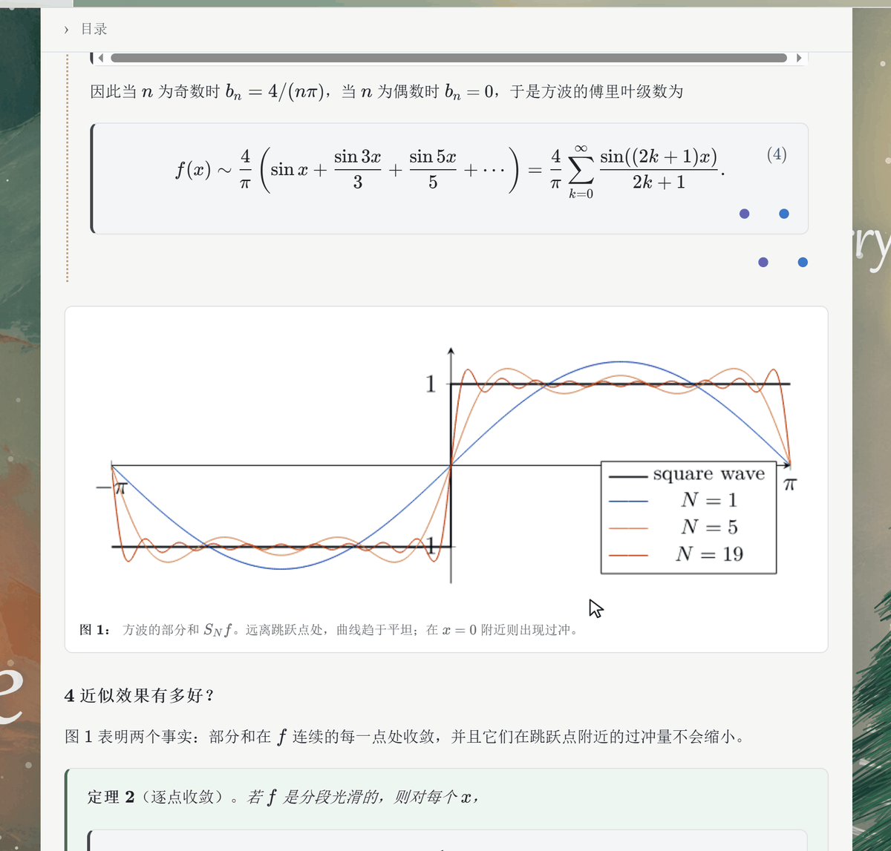
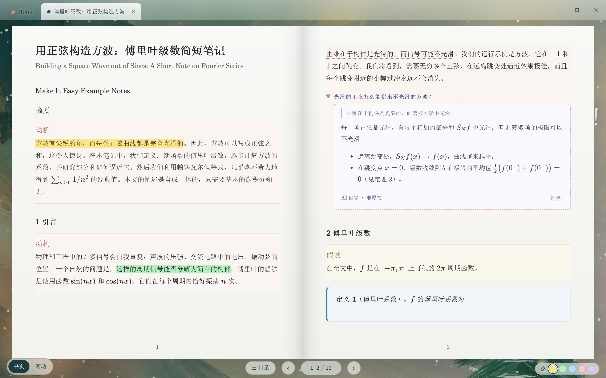

  

<h1 align="center">Make It Easy</h1>

  <b>The PDF Dimension Lifter</b> 
  <b><i>Drop in a PDF you can't follow. Get back a book you can.</i></b> 
  <i>Faithful translation, clear logical structure, page-flip reading, highlights with in-place Q&amp;A, and live interactive visualizations for any formula you're stuck on.</i>

  
  
  

  <a href="https://github.com/makeiteasy-app/make-it-easy/releases/latest"><b>⬇ 下载最新版（Windows）</b></a>
  &nbsp;·&nbsp; <a href="CHANGELOG.md">更新日志</a>
  &nbsp;·&nbsp; <a href="https://github.com/makeiteasy-app/make-it-easy/issues">问题反馈</a>

  

## 为什么做这个

读教材或者论文时，你可能也遇到过这些情况：

- 一个推导连着跳了三步，翻来覆去也看不出中间发生了什么；
- 公式写得清清楚楚，可它到底在"做"什么，脑子里没有画面；
- 外文文献交给机器翻译，术语译歪了，公式编号也乱了；
- 读到第三节，已经忘了作者的动机是什么，这一步在证明哪个结论；
- 某一句没看懂，想问 AI，却得把整篇论文重新贴一遍。

Make It Easy 想解决的就是这几件事。把论文、教材或讲义的 PDF 拖进来，点「编译」，几分钟后得到一份能读懂的版本：原文忠实翻译，论证结构标出来，排成一本可以翻页的书。哪条公式看不懂，点一下，AI 就为它现场做一个能动手操作的演示；哪句话看不懂，选中它直接问，回答就留在那句话下面。

## 功能

### ✨ 哪条公式看不懂，就为它做一个演示

每条公式右下角有两个小圆点。点蓝点得到一个**可交互实验**：可以改参数，上一步、下一步地把推导走一遍。点紫点得到一个**可视化动画**，把抽象的变换画出来。

这些演示不是事先做好的模板。AI 会读这条公式和理解它需要的上下文，当场写出参数、分步推导和计算代码，几十秒后插在公式正下方，页面不刷新。每个演示交给你之前，都会先在本地沙箱里试运行一遍，算不出来的不会给你看。演示里用到的示例数字会标明「简化示例 · AI 生成」，不会冒充原文。

演示打开时都是暂停的，点「播放」或「下一步」才动；框的大小在载入时就按最大的一步定好，操作时不会忽长忽短、把正文挤来挤去。生成要等几十秒，等不及或点错了，占位框右上角有「中止」，会停掉这次请求，不白花额度。

### 📖 像一本真书那样翻页

两页并排铺满窗口，按 `D` 或 `→` 翻到下一页，`A` 或 `←` 回上一页，也可以点底部的 ‹ ›。翻页时纸页会弯曲、带阴影。

正文可以跨页接着排，公式、图表、注释和演示不会被拆开：放不下就把这一页剩下的地方留白，整块放到下一页。演示的框固定一整页高，分步操作时不会忽长忽短。想换回长页面滚动，点左下角的「滚动」，选择会被记住。

底栏的「☰ 目录」在每一页都能打开，标出你现在读到哪一章、每章在第几页，点一下就翻过去。

### ✍️ 画笔高亮，选中就问

- **高亮**：右下角选一支画笔颜色，按住右键拖过一段文字就涂上。点高亮可以换颜色或删掉。
- **提问**：左键选中一段，下方出现输入框，写下问题回车。AI 只收到你选中的这段、它前后几段的编译结果和你的问题，不用重读整篇论文，省时间也省额度。
- **回答留在原处**：回答出现在那段文字的正下方，公式照常排好，标明「AI 回答 · 非原文」。不想看时收起，只剩一个半透明的小三角，随时再点开。

高亮和问答都存在本机，换书页 / 滚动版式、换层级、关掉再开都还在，只有你点「删除」才会删。

### 🧭 忠实翻译，论证结构标出来

翻译只做语言转换，不增删、不润色、不总结。公式、符号、编号、引用原样保留，原 PDF 随时可以打开对照。

定义、定理、证明会加框，动机、方法、推导、结论这些段落也会按 AI 读出的逻辑标出来，类别名写在框的左上角，而不是按自然段机械切分。编译时可以选四个辅助层级：

| 层级 | 内容 |
|---|---|
| 纯净 | 忠实翻译、重新排版、公式重新渲染 |
| 基础 | 加上定义、定理、证明等语义框，以及动机、方法、步骤、结论、转折的逻辑分框 |
| 深入 | 加上更细的逻辑层次，标出值得做成演示的公式 |
| 全面 | 加上更多 AI 注释，并提前生成一部分演示 |

### 📚 文献库

- 编译好的文献自动按主题分组，简称按「缩写：一句话说明」生成，可以自己改。
- 编译时显示当前在做哪一步、这一步还要多久、全部还要多久。翻译好的章节可以先读。
- 超过 8 页的文献会先出大纲，再分块同时处理。30 页左右大约 10 分钟；单份建议 150 页以内，长教材可以按章节拆成几个 PDF。
- 模型额度用完时会自动停下，标为「未完成」。额度恢复后点「补完」，只补缺的部分。
- 首页的油画背景会随圣诞、新年、春节、中秋换装。等编译的时候，底部还有一只可以玩的小恐龙，不想看见就点小三角收起来。

### 🔌 接入你自己的 AI

整个流程（解析、翻译、理解结构、写注释和演示）只用你接入的**同一个大模型**，不混用别的小模型。

- **本机命令行（推荐）**：用你已经登录的 Claude Code、Codex 或 Gemini CLI，走你自己的订阅，不需要 API 密钥。没装的话会帮你装，没登录会打开官方登录窗口。
- **云端 API**：OpenAI、Anthropic、Gemini、DeepSeek 或兼容接口。密钥只存在本机，系统支持时会加密保存。

API 的「高级」里，模型可以从这家厂商的常见型号里下拉选，也可以自己填。

语言、字体和 AI 接入都在文献列表右上角的「语言与 AI 设置」里改。字体分两部分选：西文默认是论文常用的 Computer Modern（和公式同一种字形），也可以换成 Palatino、EB Garamond、Literata 等；中文、日文、韩文、阿拉伯文、印地文各有几款常见字体，App 自带开源字体，不用另装。

## 我们的坚持

Make It Easy 的产品理念是一句话：**把复杂留给 AI，把简单留给用户。** 具体落到四条原则上：

| 原则 | 具体怎么做 |
|---|---|
| 🛡️ 忠实于作者 | 作者写的内容一个字都不改。AI 写的解释、注释、演示全部放在单独一层，标明「AI 生成」，可以随时隐藏。 |
| 强大能力 | 哪里看不懂，就为那一处现场写一个能操作的演示，先试跑校验再交给你。 |
| 极简界面 | 拖入 PDF、点「编译」，主要就这两步。接入 AI、搬存储位置、额度用完后补完，都是点一下。 |
| 专注于阅读 | 翻页阅读，演示插在原位不打断，不需要的辅助随时收起。 |

**Taste Matters.** 读一份难懂的文献已经够累了，我们希望至少看着舒服一点。所以有会换装的首页、会翻卷的纸页，和那只小恐龙。

## 安装

1. 在 [Releases](https://github.com/makeiteasy-app/make-it-easy/releases/latest) 下载 `Make-It-Easy-Setup-<版本>.exe`，运行时可以自己选安装位置，不必装在 C 盘。也可以下载 zip 免安装版，解压后运行 `Make It Easy.exe`。
2. 安装包暂时没有数字签名，Windows 可能提示「已保护你的电脑」，点「更多信息」再点「仍要运行」。
3. 打开后选一种 AI 接入方式，就可以拖入 PDF 了。

仅支持 64 位 Windows 10 / 11。

想先试试效果，可以下载 Release 里的 `fourier-square-wave.pdf`。这是一篇为演示专门写的三页短文，讲怎样用正弦波拼出方波，可以自由使用（CC0）。本页的截图都来自它。

## 常见问题

**要花钱吗？**
目前发布的版本个人学习、研究和学校使用都免费（商业用途需要授权，见下方「许可」）。AI 用的是你自己的订阅或 API 额度。用本机的 Claude Code、Codex 或 Gemini CLI 时，走的是你已有的订阅。

**选中提问要花很多额度吗？**
不多。每次只发选中的文字、它所在的几段和你的问题，通常一千字以内，不会把整篇论文再发一遍。

**一份文献要编译多久？**
30 页左右大约 10 分钟，层级越高越久。编译中途可以先读已经翻译好的部分。

**只能读论文吗？**
不是。教材、讲义、技术报告、学位论文都可以，带公式的理工科内容效果最好。能选中文字的 PDF 处理最快；扫描版也能处理，但更慢。

**数据存在哪里？**
都在你自己的电脑上，默认在 `%APPDATA%\Make It Easy`。文献列表右上角的「存储位置」可以把设置、缓存和文献库一键搬到别的盘（例如 D 盘）。编译完成后会自动删掉逐页渲染图，大约省一半空间。

**安装后打不开？**
安装时程序会先解压到 C 盘的临时文件夹（约 400 MB，装完自动删除）。C 盘剩余空间不足 1 GB 时，安装可能中途失败。清理出空间后重新安装即可。

**我编译出来的译文可以分享吗？**
译文的授权跟随原文。原文是 CC BY 等开放许可的，可以按许可要求署名后分享；版权保留的，请只用于个人学习，不要公开分享译文。

**遇到问题怎么反馈？**
在 [Issues](https://github.com/makeiteasy-app/make-it-easy/issues) 里提，选「问题报告」或「功能建议」模板；使用心得和讨论可以发在 [Discussions](https://github.com/makeiteasy-app/make-it-easy/discussions)。

## 许可

- 每个版本适用哪种条款，以发布时附带的许可为准，详见 [LICENSING.md](LICENSING.md)。目前已发布的版本（到 V4.1 alpha 为止）都采用 [PolyForm Noncommercial 1.0.0](LICENSE)：个人学习、研究、兴趣项目，以及学校、公益和科研机构使用都免费，也可以转给别人（转发时附上许可条款）。**不允许商业用途**；想在商业场景使用，请通过 Issues 联系作者。
- 本仓库只提供安装包和文档，源码不公开。
- App 用到的第三方组件（Electron、KaTeX、PDF.js、StPageFlip、开源字体等）保留各自的许可，许可文本随安装包一起提供。
- 隐私：你的文献和数据都留在自己电脑上，见 [PRIVACY.md](PRIVACY.md)。
